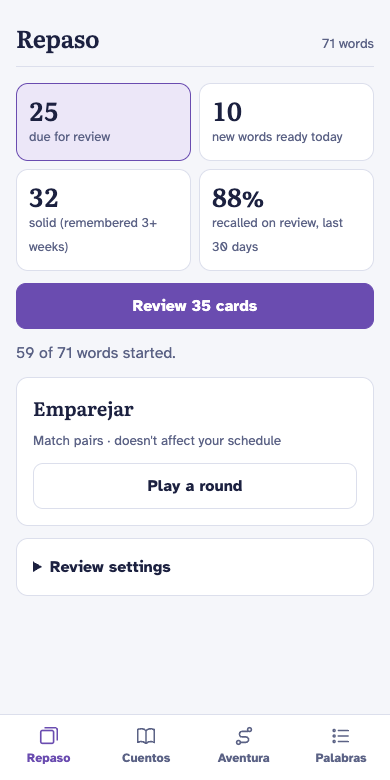
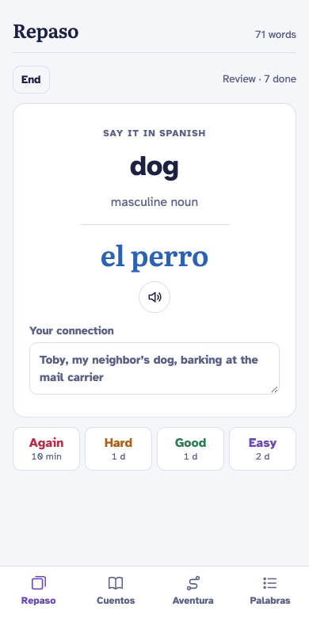
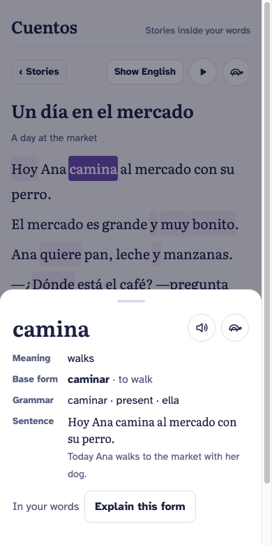
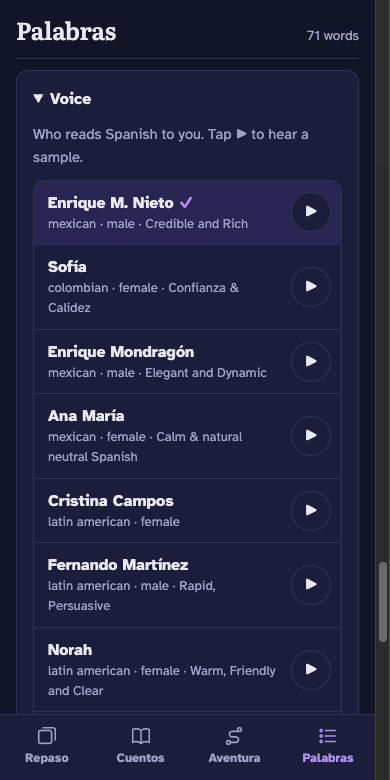

# Palabra Viva

A Latin American Spanish trainer for adults who want to actually learn the language, built
around the parts of Duolingo that work and without the parts that exist to keep you on the app.

<table>
<tr><td></td><td></td><td></td><td></td></tr>
<tr><td align="center">Review</td><td align="center">Flashcard</td><td align="center">Story</td><td align="center">Voice</td></tr>
</table>

## What it's for

- **Remember words for good.** Spaced-repetition flashcards: Spanish → English first, then
English → Spanish once you know the meaning. Nouns are colored by gender, and every card has
room for your own connection to the word.
- **Read real Spanish early.** Claude writes short stories and choose-your-own-adventures using
the words you already know, plus a few new ones you can guess from context. Tap any word for
its meaning, base form and grammar.
- **Hear it the way people say it.** Native Latin American voices read every word and sentence,
and stories play along sentence by sentence.
- **Latin American Spanish throughout:** *ustedes*, not *vosotros*; *carro*, *celular*,
*computadora*, *jugo*.

## What it leaves out

No streaks, leagues, hearts, guilt notifications or inflated progress. The numbers are the plain ones:
cards due, new words ready today, words that have stuck for three weeks or more, and your real
recall rate over the last 30 days.

## Using it

Paste your Duolingo word list (any messy format works) and it becomes your deck, or start from
the built-in starter words. To join, ask for an account with your email; once it's approved
you get a personal login link, with no password to remember, and your words and history follow
you between phone and laptop.

## Running your own

One HTML file and a small Python server with sqlite:

```sh
docker build -t palabras .
docker run -d --name palabras -p 8080:8080 -v palabras:/data \
  -e PV_PUBLIC=http://localhost:8080 \
  -e ANTHROPIC_API_KEY=… -e ELEVENLABS_API_KEY=… palabras
docker exec palabras python3 server.py adduser yourname # prints your login link
docker exec palabras python3 server.py admin yourname   # lets you approve account requests in the app
```

Both keys are optional. Without Claude, stories and adventures stay hidden; without ElevenLabs,
the device's own voice reads aloud. [AGENTS.md](AGENTS.md) explains how the pieces fit.

## License

[MIT](LICENSE)
